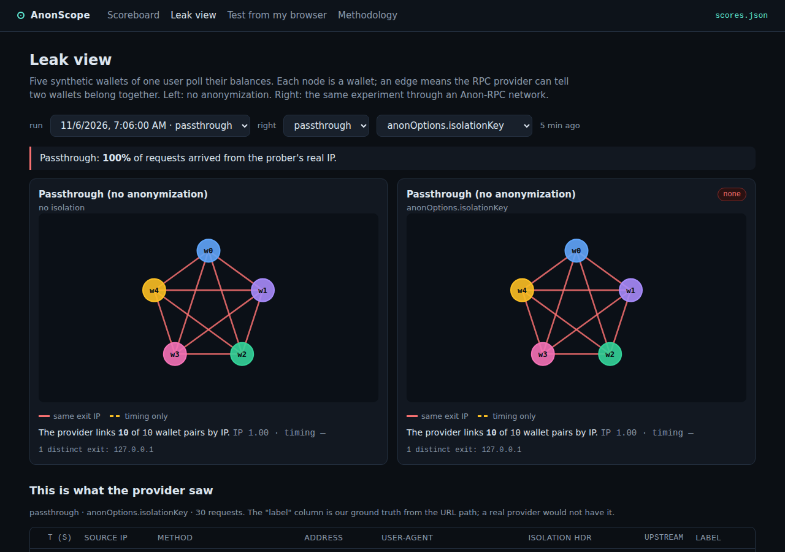

# AnonScope: an observatory for Anon-RPC

> Built at ETHGlobal Mumbai (Nov 6–8, 2026) for the Ethereum Foundation **🕶️ Best Use of Anon-RPC** and **🌾 Best CROPS App** tracks.

Anon-RPC lets wallets and dApps send RPC reads through anonymity networks (tor-js, Nym, Nox) instead of revealing their IP and addresses to an RPC provider. But nobody publicly measures **whether it actually works**. The spec leaves isolation strength "up to the worker", networks differ in latency and availability, and some RPC providers refuse anonymity-network exits.

AnonScope is a live observatory. It runs a fixed experiment suite through every Anon-RPC network against an RPC endpoint we control, which logs exactly what a provider would see. It publishes a scoreboard covering bootstrap time, latency, overhead, error rate, **wallet unlinkability** (with and without isolation keys, and against a timing adversary), identifying-header leaks, real-IP leaks, and which public RPC providers accept each network. Wallets can consume the scores as JSON to choose a network.

- **Live:** `https://<your-app>.fly.dev` *(fill in after `fly deploy`)*
- **Scores for wallets:** `https://<your-app>.fly.dev/api/scores.json`



*Leak view from a local passthrough-only run: five wallets, one IP, all ten pairs linked. The right-hand graph shows the chosen network once runs from the deployed observer exist.*

## Run it locally

Requires Node ≥ 22 and pnpm 10.

```sh
pnpm i
pnpm pin        # build-time: read the specifier contracts → packages/shared/src/pins.json,
                # then download + keccak-verify each worker bundle → packages/web/public/bundles/
pnpm dev        # observer on :8787 + Vite on :5173 (proxying /api, /rpc, /whoami)
pnpm test       # 65 unit tests (analysis, observer, privacy, pacer, fixtures)
```

`pins.json` is committed, so `pnpm bundles` alone is enough if you don't want to re-read the chain.

Production-style, on one port:

```sh
pnpm bundles && pnpm build && pnpm start      # http://localhost:8787
pnpm --filter @anonscope/runner install-browser   # once: Playwright Chromium
RUNNER_ORIGIN=http://localhost:8787 RUNNER_NETWORKS=passthrough pnpm runner
```

Locally only **passthrough** can reach your observer. Tor, Nym and Nox exits need a **public** observer URL (deploy below).

### Environment

| var | default | used by |
|---|---|---|
| `PORT` | `8787` | observer |
| `DB_PATH` | `./data/anonscope.db` | observer (SQLite) |
| `TRUSTED_IP_HEADER` | *(empty → socket address)* | observer. `fly-client-ip` on Fly. Never set it to `x-forwarded-for` unless your proxy overwrites that header |
| `UPSTREAM_RPC_MAINNET` / `UPSTREAM_RPC_SEPOLIA` | publicnode | observer forwards allow-listed reads here |
| `PUBLIC_ORIGIN` | `http://localhost:8787` | `scores.json` `observer` field; runner target |
| `RUNNER_TOKEN` | *(empty: scheduled runs open)* | required to claim `mode: scheduled` runs |
| `SEED_FIXTURE` | — | import a recorded run at startup |
| `CSP` | `strict` | `off` disables the app's Content-Security-Policy |
| `RUNNER_ORIGIN`, `RUNNER_NETWORKS`, `RUNNER_HEADLESS` (`new`/`old`/`false`), `RUNNER_INTERVAL_MIN` | | runner |
| `VITE_OBSERVER_ORIGIN` | same origin | web build: where probes/API go |
| `VITE_BUNDLE_FALLBACK=1` | off | web build: let the harness fall back to the specifiers' CDN resolvers |

See `.env.example`.

## Deploy (Fly.io)

```sh
fly launch --no-deploy --copy-config          # pick a unique app name; edit fly.toml app + PUBLIC_ORIGIN
fly volumes create anonscope_data --size 1 --region bom
fly secrets set RUNNER_TOKEN=$(openssl rand -hex 16)
fly deploy
curl -X POST https://<app>.fly.dev/rpc/mainnet/test/manual/baseline/- \
  -H 'content-type: application/json' -d '{"jsonrpc":"2.0","id":1,"method":"eth_blockNumber","params":[]}'

# scheduled runner (separate app: headless Chromium every 30 min)
fly launch --no-deploy -c fly.runner.toml --copy-config   # set RUNNER_ORIGIN to the observer URL
fly secrets set -c fly.runner.toml RUNNER_TOKEN=<same token>
fly deploy -c fly.runner.toml
```

Or run the loop on any machine with a browser: `RUNNER_ORIGIN=https://<app>.fly.dev RUNNER_TOKEN=… pnpm runner:loop`. Any VPS with Caddy in front of `pnpm start` also works. Set `TRUSTED_IP_HEADER` to whatever the proxy writes.

Backup demo data: after a good run, `pnpm seed export <runId> --db <db>` writes `fixtures/demo-run.json`. Set `SEED_FIXTURE=/app/fixtures/demo-run.json` (or run `pnpm seed import`) to load it anywhere. Fixtures are labelled "recorded" in the UI and are never deleted by retention.

## Architecture

```
                ┌───────────────────────── browser (prober) ─────────────────────────┐
                │  React app (Vite)                                                  │
                │   ├─ Experiment runner ──► AnonRpcWorker(passthrough | tor-js |    │
                │   │                         nym | nox)  ── worker.fetch() ──┐      │
                │   ├─ Leak view (graph)                                      │      │
                │   └─ Scoreboard (reads /api/scores.json)                    │      │
                └─────────────────────────────────────────────────────────────┼──────┘
                                                                              │ via anonymity network
                                                                              ▼ (exit IP)
   Playwright runner (headless Chromium, cron) ──opens──► /run?mode=scheduled
                                                                              │
                ┌──────────────────────── observer (Node, public HTTPS) ──────▼──────┐
                │  POST /rpc/:chain/:runId/:network/:variant/:wallet                 │
                │     → logs {ts, srcIp, headers, method, params, upstreamMs}        │
                │     → forwards allowed read methods to UPSTREAM_RPC_{chain}        │
                │  GET  /whoami          (scheduled runner only: ground-truth IP)    │
                │  POST /api/runs/claim, /api/runs  (run registration + timings)     │
                │  GET  /api/runs, /api/runs/:id/{report,logs},                      │
                │       /api/scores.json, /api/history                               │
                │  serves the built React app + self-hosted worker bundles at /      │
                │  SQLite (better-sqlite3) on a persistent volume, 14-day retention  │
                └────────────────────────────────────────────────────────────────────┘
```

```
packages/shared    types, networks.ts (from adopters.json5), pins.json, providers, analysis/* (pure, tested)
packages/observer  Hono server: /rpc probe proxy, /api, /whoami, static app; SQLite
packages/web       harness layer (PinnedProvider, worker factory, rpc wrapper, pacer), experiments, pages
packages/runner    Playwright scheduled runner (run once / loop)
scripts/           pin-specifiers.ts, fetch-bundles.ts, seed-demo.ts, check-dist.mjs
spikes/            Phase 0 spike page + driver
docs/              methodology, spike findings, EF feedback, demo script
```

**Why a self-run observer:** to measure what an RPC provider sees, we have to *be* the provider. Path labels (`network/variant/wallet`) give us ground truth for scoring. The adversary in the metrics uses only source IP, timing and headers, as a real provider would.

## Traffic disclosure

Every network request the app makes:

| Traffic | Path | Through Anon-RPC? | Why |
|---|---|---|---|
| Probe RPC reads (E2, E3) | browser → network → observer `/rpc` → upstream RPC | ✅ `worker.fetch` | the measurement |
| Provider compatibility (E5) | browser → network → public provider | ✅ `worker.fetch` | the measurement |
| Baseline | passthrough worker → observer | ✅ (harness, no anonymity by design) | comparison |
| Specifier read | build-time `pnpm pin` → public RPC | ❌, build time only | harness bootstrap. At runtime `PinnedProvider` answers both `eth_call`s from `pins.json` |
| Worker bundle | build-time `pnpm bundles` → specifier resolvers (CDNs); runtime browser → **our observer** `/bundles/<hash>.js` | n/a (static, keccak-verified by the harness) | keeps visitors from contacting jsDelivr/unpkg/GitHub. `kps:` resolvers are listed as fallback |
| `/whoami` | scheduled runner → observer, 3× per run | ❌ | ground truth for the real-IP-leak metric; scheduled runner only |
| Run claim, upload + report (scheduled) | runner browser → observer `/api` | ❌ (not RPC) | our own runner |
| Run claim, upload + report (visitor) | browser → **tor-js worker** → observer `/api` | ✅ | so the visitor's IP isn't linked to their run |
| Dashboard, `scores.json`, app assets | browser → observer | n/a (not RPC) | static assets and results |

Check: `grep -rn "fetch(" packages/web/src`. The only raw `fetch` calls are `lib/api.ts` (dashboard `/api` GETs) and `experiments/runSuite.ts` (`/whoami`, and scheduled-mode `/api`). Every RPC read uses `worker.fetch` via `harness/rpc.ts`.

## Methodology (summary)

Full write-up: [`docs/methodology.md`](docs/methodology.md), also rendered at `/methodology`.

- **Adversary:** an RPC provider seeing source IP, arrival time, headers and payload, trying to link 5 wallets of one user. JSON-RPC ids are random so they can't link requests.
- **Experiments per network:** E1 boot · E2 15× `eth_blockNumber` · E3 5 fresh synthetic wallets × balance + nonce × 3 rounds, for each of `nokey`, `isokey` (`anonOptions.isolationKey`), `header` (`x-anon-rpc-isolation`), `isokey_jitter` · E5 `eth_chainId` to 6 keyless providers. At most 141 requests per network per run, paced to 55/min.
- **IP linkability** = pairs sharing an exit within 60 s / C(5,2). **Timing linkability** = pairs not IP-linked whose requests coincide within 250 ms in ≥ 2 rounds. **Real-IP leak** = share of requests from the runner's own IPs. **Overhead** = p50(client ms − upstream ms), matched by request id.
- **Verdict:** effective ≤ 0.1 < partial < 0.9 ≤ none; unsupported if the mechanism makes calls fail.
- **Scores:** median of the last 6 scheduled runs.

## Findings so far

From Phase 0 spikes ([`docs/spike-findings.md`](docs/spike-findings.md)). Update with live scoreboard numbers once the observer has run for a while.

- **No pinned worker implements `isolationKey`.** None of the four bundles reads `anonOptions`. Live: passthrough and **Nym use one exit for every key**; **Nox rotates per request across 3 exits** regardless of key. Expected verdicts: none / none / partial.
- **`x-anon-rpc-isolation` leaks.** Passthrough and Nox forward it to the destination, so the per-account key reaches the provider. Nym drops it but doesn't act on it.
- **Header fingerprints:** passthrough sends the real browser UA + `Origin: null` + `Sec-Fetch-*`. Nox sends `Nox-Proxy/1.0`. Nym sends a fixed fake Chrome 131 UA + `Accept-Language: en-US`.
- **Boot:** passthrough ~50 ms, Nox ~2 s, Nym ~8 s. **tor-js** couldn't bootstrap from our network on day 1: the demo gateway timed out (`kps: HELLO timeout`) while Nox's KPS worked fine.
- **Specifier resolvers are third-party CDNs**, so a stock integration leaks each user's IP to jsDelivr/unpkg at boot. AnonScope self-hosts the hash-verified bytes instead.

## CROPS

- **C (control):** We control only the observer domain and the runner. If they disappear, the repo still runs anywhere with one command (`pnpm bundles && pnpm build && pnpm start`), and `scores.json` is reproducible from the code. Networks are pinned by on-chain specifier hash. Bundles are served by us, but trust comes from the keccak hash, not from us.
- **O (open):** MIT. Builds and runs from the repo alone. No accounts or API keys required.
- **P (privacy):** The observer sees only synthetic probe traffic: random addresses and exit IPs, never visitor wallets. Only the `/rpc` probe route stores IPs. There is no request logging, and a test (`packages/observer/test/privacy.test.ts`) asserts that no other route writes an IP to the DB or console. Visitor runs register, upload and fetch reports **through Tor**. No analytics, trackers, web fonts or CDNs: the app ships a strict CSP (`script-src 'self'; connect-src 'self'`), worker bundles are self-hosted, and `pnpm check:dist` verifies the build. Data is deleted after 14 days.
- **S (security):** No keys held: synthetic private keys are discarded as soon as the address is derived. The proxy only forwards `eth_chainId, eth_blockNumber, eth_getBalance, eth_getTransactionCount, eth_getCode, eth_call` (no batches), so it can't be used to send transactions. Rate limits: 60/min per run, 600/min global, one visitor run per 5 min, and scheduled runs need a token. The worker runs in the harness's null-origin sandbox, and its bytes are hash-verified before execution.

## AI usage disclosure

This project was built with **Claude Code** (Anthropic), working from the human-written plan in [`plan.md`](plan.md). Claude Code wrote the code, tests and docs, ran the Phase 0 spikes, and inspected the published harness and worker bundles. The human set the idea, the plan and the prize strategy, and handles deployment, the demo and submission.

## License

[MIT](LICENSE)
