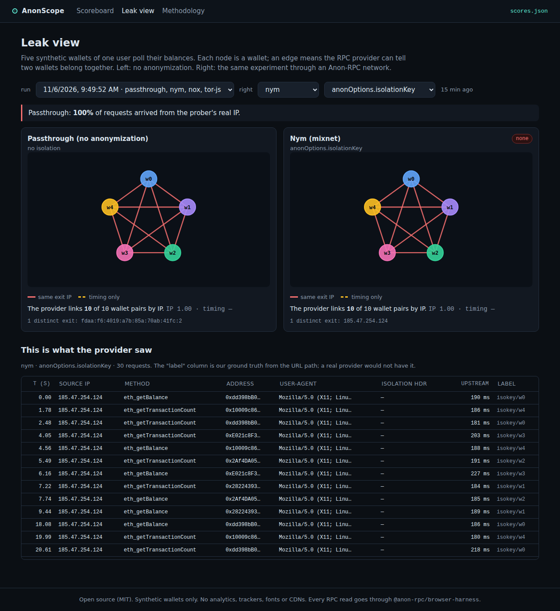
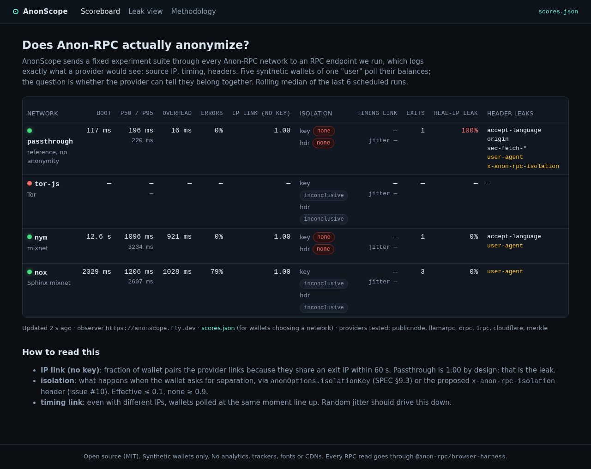

# AnonScope: an observatory for Anon-RPC

> Built at ETHGlobal Mumbai (Nov 6–8, 2026) for the Ethereum Foundation **🕶️ Best Use of Anon-RPC** and **🌾 Best CROPS App** tracks.

Anon-RPC lets wallets and dApps send RPC reads through anonymity networks (tor-js, Nym, Nox) instead of revealing their IP and addresses to an RPC provider. But nobody publicly measures **whether it actually works**. The spec leaves isolation strength "up to the worker", networks differ in latency and availability, and some RPC providers refuse anonymity-network exits.

AnonScope is a live observatory. It runs a fixed experiment suite through every Anon-RPC network against an RPC endpoint we control, which logs exactly what a provider would see. It publishes a scoreboard covering bootstrap time, latency, overhead, error rate, **wallet unlinkability** (with and without isolation keys, and against a timing adversary), identifying-header leaks, real-IP leaks, and which public RPC providers accept each network. Wallets can consume the scores as JSON to choose a network.

- **Live:** https://anonscope.fly.dev (scoreboard) · https://anonscope.fly.dev/leak (leak view) · https://anonscope.fly.dev/methodology
- **Scores for wallets:** https://anonscope.fly.dev/api/scores.json
- **Code:** https://github.com/Dhananjay-alt/AnonScope

A headless runner on Fly.io (Singapore) runs the full suite against the live observer once an hour until 2026-11-10 06:00 IST, then the deployment stops (see [Cost guardrails](#cost-guardrails)).



*Leak view from a scheduled run on Fly: five wallets over passthrough (left) and over Nym with `anonOptions.isolationKey` (right). In both, one exit IP links all ten wallet pairs.*



## Run it locally

Requires Node ≥ 22 and pnpm 10.

```sh
pnpm i
pnpm pin        # build-time: read the specifier contracts → packages/shared/src/pins.json,
                # then download + keccak-verify each worker bundle → packages/web/public/bundles/
pnpm dev        # observer on :8787 + Vite on :5173 (proxying /api, /rpc, /whoami)
pnpm test       # 69 unit tests (analysis, observer, privacy, egress cap, pacer, fixtures)
```

`pins.json` is committed, so `pnpm bundles` alone is enough if you don't want to re-read the chain.

Production-style, on one port:

```sh
pnpm bundles && pnpm build && pnpm start      # http://localhost:8787
pnpm --filter @anonscope/runner install-browser   # once: Playwright Chromium
RUNNER_ORIGIN=http://localhost:8787 RUNNER_NETWORKS=passthrough pnpm runner
```

Locally only **passthrough** can reach your observer. Tor, Nym and Nox exits need a **public** observer URL (deploy below).

### Environment

| var | default | used by |
|---|---|---|
| `PORT` | `8787` | observer |
| `DB_PATH` | `./data/anonscope.db` | observer (SQLite) |
| `TRUSTED_IP_HEADER` | *(empty → socket address)* | observer. `fly-client-ip` on Fly. Never set it to `x-forwarded-for` unless your proxy overwrites that header |
| `UPSTREAM_RPC_MAINNET` / `UPSTREAM_RPC_SEPOLIA` | publicnode | observer forwards allow-listed reads here |
| `PUBLIC_ORIGIN` | `http://localhost:8787` | `scores.json` `observer` field; runner target |
| `RUNNER_TOKEN` | *(empty: scheduled runs open)* | required to claim `mode: scheduled` runs |
| `SEED_FIXTURE` | — | import a recorded run at startup |
| `CSP` | `strict` | `off` disables the app's Content-Security-Policy |
| `EGRESS_CAP_GB` | `2` | observer: outgoing-data cap per UTC day (see Cost guardrails) |
| `RUNNER_ORIGIN`, `RUNNER_NETWORKS`, `RUNNER_HEADLESS` (`new`/`old`/`false`), `RUNNER_TIMEOUT_MIN`, `RUNNER_INTERVAL_MIN` (loop only) | | runner |
| `VITE_OBSERVER_ORIGIN` | same origin | web build: where probes/API go |
| `VITE_BUNDLE_FALLBACK=1` | off | web build: let the harness fall back to the specifiers' CDN resolvers |
| `VITE_VISITOR_TEST=1` | off | web build: show "Test from my browser" (runs over tor-js; hidden while tor-js doesn't boot) |

See `.env.example`.

## Deploy (Fly.io)

```sh
fly launch --no-deploy --copy-config          # pick a unique app name; edit fly.toml app + PUBLIC_ORIGIN
fly volumes create anonscope_data --size 1 --region sin
fly secrets set RUNNER_TOKEN=$(openssl rand -hex 16)
fly deploy --ha=false                         # exactly one machine
curl https://<app>.fly.dev/api/health

# scheduled runner: separate app, one machine that Fly starts hourly; each start
# runs the suite once (hard cap 20 min) and the machine stops when it exits
fly apps create <app>-runner                  # set app + RUNNER_ORIGIN in fly.runner.toml
fly secrets set -a <app>-runner RUNNER_TOKEN=<same token>
fly deploy -c fly.runner.toml --ha=false
fly machine update <id> -a <app>-runner --schedule hourly --restart no --skip-start -y
```

Or run the loop on any machine with a browser: `RUNNER_ORIGIN=https://<app>.fly.dev RUNNER_TOKEN=… pnpm runner:loop`. Any VPS with Caddy in front of `pnpm start` also works. Set `TRUSTED_IP_HEADER` to whatever the proxy writes.

Backup demo data: after a good run, `pnpm seed export <runId> --db <db>` writes `fixtures/demo-run.json`. Set `SEED_FIXTURE=/app/fixtures/demo-run.json` (or run `pnpm seed import`) to load it anywhere. Fixtures are labelled "recorded" in the UI and are never deleted by retention.

## Cost guardrails

Live from 2026-11-06 to the kill switch on **2026-11-10 06:00 IST**, in Fly region `sin`:

| guard | where |
|---|---|
| Observer: 1 machine, shared-cpu-1x / 512 MB, always on | `fly.toml`, `fly deploy --ha=false` |
| Runner: 1 machine, shared-cpu-2x / 2 GB, started hourly, `timeout 20m`, then stops | `fly.runner.toml`, `Dockerfile.runner` |
| Volume: one 1 GB volume, no auto-extend | `fly.toml` |
| IPs: shared IPv4 + IPv6 only | watchdog releases any dedicated IPv4 |
| Watchdog (hourly): destroys machines beyond 1 per app, stops the runner after 25 min, releases dedicated IPv4, alerts on extra volumes | `.github/workflows/watchdog.yml` |
| Kill switch: stops both apps at `KILL_AT` and keeps them stopped (observer autostart off, runner schedule removed); destroys nothing | `.github/workflows/killswitch.yml` |
| Outgoing data: above 2 GB per UTC day, dashboard/static/API answer 503; `/rpc` probes keep working (with their rate limits). Counter at `/api/health` | `packages/observer/src/egress.ts` |

The workflows need two repo secrets, each a deploy token scoped to one app: `FLY_TOKEN_OBSERVER` (`fly tokens create deploy -a anonscope -x 168h`) and `FLY_TOKEN_RUNNER` (same, `-a anonscope-runner`). Run either workflow manually and it defaults to a dry run.

**Worst case up to Nov 10 ≈ $3.0, under $3.3 / ₹290.** That's 87 h at Fly's prices (docs.fly.io/about/pricing, 2026-11-06, `sin` ≈ 1.27× the listed rate): observer $0.57, runner $2.05 *if it ran nonstop* (with the guards it runs ≤ 20 min/h, ≈ $0.4–0.7), egress 2 GB/day × $0.04 ≈ $0.29, volume + stopped rootfs ≈ $0.07, shared IPv4 free.

**Manual kill:**

```sh
fly scale count 0 -a anonscope --yes
fly scale count 0 -a anonscope-runner --yes
```

`scale count 0` **destroys** the machines. The volume, its data, IPs and secrets stay, and `fly deploy` recreates the machines. To stop them without destroying anything, do what the kill switch does: `fly machine stop <id> -a <app>`, then for the observer `fly machine update <id> -a anonscope --autostart=false --skip-start -y` (otherwise traffic wakes it).

## Architecture

```
                ┌───────────────────────── browser (prober) ─────────────────────────┐
                │  React app (Vite)                                                  │
                │   ├─ Experiment runner ──► AnonRpcWorker(passthrough | tor-js |    │
                │   │                         nym | nox)  ── worker.fetch() ──┐      │
                │   ├─ Leak view (graph)                                      │      │
                │   └─ Scoreboard (reads /api/scores.json)                    │      │
                └─────────────────────────────────────────────────────────────┼──────┘
                                                                              │ via anonymity network
                                                                              ▼ (exit IP)
   Playwright runner (headless Chromium, cron) ──opens──► /run?mode=scheduled
                                                                              │
                ┌──────────────────────── observer (Node, public HTTPS) ──────▼──────┐
                │  POST /rpc/:chain/:runId/:network/:variant/:wallet                 │
                │     → logs {ts, srcIp, headers, method, params, upstreamMs}        │
                │     → forwards allowed read methods to UPSTREAM_RPC_{chain}        │
                │  GET  /whoami          (scheduled runner only: ground-truth IP)    │
                │  POST /api/runs/claim, /api/runs  (run registration + timings)     │
                │  GET  /api/runs, /api/runs/:id/{report,logs},                      │
                │       /api/scores.json, /api/history                               │
                │  serves the built React app + self-hosted worker bundles at /      │
                │  SQLite (better-sqlite3) on a persistent volume, 14-day retention  │
                └────────────────────────────────────────────────────────────────────┘
```

```
packages/shared    types, networks.ts (from adopters.json5), pins.json, providers, analysis/* (pure, tested)
packages/observer  Hono server: /rpc probe proxy, /api, /whoami, static app; SQLite
packages/web       harness layer (PinnedProvider, worker factory, rpc wrapper, pacer), experiments, pages
packages/runner    Playwright scheduled runner (run once / loop)
scripts/           pin-specifiers.ts, fetch-bundles.ts, seed-demo.ts, check-dist.mjs
spikes/            Phase 0 spike page + driver
docs/              methodology, spike findings, EF feedback, demo script
```

**Why a self-run observer:** to measure what an RPC provider sees, we have to *be* the provider. Path labels (`network/variant/wallet`) give us ground truth for scoring. The adversary in the metrics uses only source IP, timing and headers, as a real provider would.

## Traffic disclosure

Every network request the app makes:

| Traffic | Path | Through Anon-RPC? | Why |
|---|---|---|---|
| Probe RPC reads (E2, E3) | browser → network → observer `/rpc` → upstream RPC | ✅ `worker.fetch` | the measurement |
| Provider compatibility (E5) | browser → network → public provider | ✅ `worker.fetch` | the measurement |
| Baseline | passthrough worker → observer | ✅ (harness, no anonymity by design) | comparison |
| Specifier read | build-time `pnpm pin` → public RPC | ❌, build time only | harness bootstrap. At runtime `PinnedProvider` answers both `eth_call`s from `pins.json` |
| Worker bundle | build-time `pnpm bundles` → specifier resolvers (CDNs); runtime browser → **our observer** `/bundles/<hash>.js` | n/a (static, keccak-verified by the harness) | keeps visitors from contacting jsDelivr/unpkg/GitHub. `kps:` resolvers are listed as fallback |
| `/whoami` | scheduled runner → observer, 3× per run | ❌ | ground truth for the real-IP-leak metric; scheduled runner only |
| Run claim, upload + report (scheduled) | runner browser → observer `/api` | ❌ (not RPC) | our own runner |
| Run claim, upload + report (visitor; switched off while tor-js doesn't boot) | browser → **tor-js worker** → observer `/api` | ✅ | so the visitor's IP isn't linked to their run |
| Dashboard, `scores.json`, app assets | browser → observer | n/a (not RPC) | static assets and results |

Check: `grep -rn "fetch(" packages/web/src`. The only raw `fetch` calls are `lib/api.ts` (dashboard `/api` GETs) and `experiments/runSuite.ts` (`/whoami`, and scheduled-mode `/api`). Every RPC read uses `worker.fetch` via `harness/rpc.ts`.

## Methodology (summary)

Full write-up: [`docs/methodology.md`](docs/methodology.md), also rendered at `/methodology`.

- **Adversary:** an RPC provider seeing source IP, arrival time, headers and payload, trying to link 5 wallets of one user. JSON-RPC ids are random so they can't link requests.
- **Experiments per network:** E1 boot · E2 15× `eth_blockNumber` · E3 5 fresh synthetic wallets × balance + nonce × 3 rounds, for each of `nokey`, `isokey` (`anonOptions.isolationKey`), `header` (`x-anon-rpc-isolation`), `isokey_jitter` · E5 `eth_chainId` to 6 keyless providers. At most 141 requests per network per run, paced to 55/min.
- **IP linkability** = pairs sharing an exit within 60 s / C(5,2). **Timing linkability** = pairs not IP-linked whose requests coincide within 250 ms in ≥ 2 rounds. **Real-IP leak** = share of requests from the runner's own IPs. **Overhead** = p50(client ms − upstream ms), matched by request id.
- **Verdict:** effective ≤ 0.1 < partial < 0.9 ≤ none. *Unsupported* if the mechanism's calls fail while the network works before and after it; *inconclusive* if there's no data or the network itself went down.
- **Scores:** median of the last 6 scheduled runs.

## Findings so far

From the scheduled runs on Fly.io (runner and observer in `sin`, headless Chromium, harness 0.4.0), as of 2026-11-06 10:00 UTC: **2 runs**, `c45dcf0b` and `d3182a6a`. The live scoreboard updates hourly. Spike results from a laptop are in [`docs/spike-findings.md`](docs/spike-findings.md) and aren't counted here.

| | passthrough | Nym | Nox | tor-js |
|---|---|---|---|---|
| boot (median) | 117 ms | 12.6 s | 2.3 s | did not boot (120 s timeout, 2/2 runs) |
| latency p50 / p95 | 196 / 220 ms | 1096 / 3234 ms | 1206 / 2607 ms | — |
| overhead vs upstream (p50) | 16 ms | 921 ms | 1028 ms | — |
| error rate | 0% | 0% | 78% (see below) | — |
| exit IPs seen per run | 1 (the runner's own) | 1 (a different one each run) | 3 (the same 3 in both runs) | — |
| IP linkability, no key | 1.00 | 1.00 | 1.00 | — |
| `anonOptions.isolationKey` | none (1.00) | none (1.00) | inconclusive (no requests got through) | inconclusive |
| `x-anon-rpc-isolation` header | none (1.00), header reaches the provider | none (1.00), header doesn't reach the provider | inconclusive | inconclusive |
| identifying headers at the provider | browser UA, `Accept-Language`, `Origin: null`, `Sec-Fetch-*`, the isolation header | fixed Chrome UA, `Accept-Language: en-US` | `User-Agent: Nox-Proxy/1.0` | — |
| providers reachable through it (E5) | 4/6 | 3/6 | 0/6 | — |

- **Isolation keys don't separate wallets on any network that ran.** On passthrough and Nym, all five wallets of one user arrived from one IP in every variant, so the provider links all 10 pairs whether or not the wallet sets `isolationKey` or the header. That matches the bundles: none of the four pinned workers reads `anonOptions`.
- **Nym** uses one exit per session. Across the two runs it was `217.118.194.66` and then `185.47.254.124`. It drops `x-anon-rpc-isolation`.
- **Nox** spread the no-key requests over 3 AWS exits, but with 5 wallets polling within a minute, every pair still shared an exit (linkability 1.00). In both runs the Nox worker answered all 15 sequential E2 requests, then began returning `NoxWorkerError: network-error` about 30 s into the concurrent E3 phase and didn't recover for the rest of the run (E3 keyed variants and E5: 0 successes). Its isolation verdicts are therefore *inconclusive*, not *unsupported*. The cause isn't determined; a run from a residential connection in Mumbai earlier the same day completed all variants.
- **tor-js** didn't boot from Fly either (as on day 1 from the laptop): the demo gateway in `adopters.json5` times out (`kps: HELLO timeout`). The scoreboard shows it as unavailable, and "Test from my browser", which runs over tor-js, is switched off.
- **Timing linkability** is "—" everywhere: it only scores pairs that IP doesn't already link, and IP linked every pair.
- **Specifier resolvers are third-party CDNs**, so a stock integration makes every user fetch the bundle from jsDelivr/unpkg at boot. AnonScope serves the hash-verified bytes itself.

## CROPS

- **C (control):** We control only the observer domain and the runner. If they disappear, the repo still runs anywhere with one command (`pnpm bundles && pnpm build && pnpm start`), and `scores.json` is reproducible from the code. Networks are pinned by on-chain specifier hash. Bundles are served by us, but trust comes from the keccak hash, not from us.
- **O (open):** MIT. Builds and runs from the repo alone. No accounts or API keys required.
- **P (privacy):** The observer sees only synthetic probe traffic: random addresses and exit IPs, never visitor wallets. Only the `/rpc` probe route stores IPs. There is no request logging, and a test (`packages/observer/test/privacy.test.ts`) asserts that no other route writes an IP to the DB or console. Visitor runs (switched off until tor-js boots) register, upload and fetch reports **through Tor**. No analytics, trackers, web fonts or CDNs: the app ships a strict CSP (`script-src 'self'; connect-src 'self'`), worker bundles are self-hosted, and `pnpm check:dist` verifies the build. Data is deleted after 14 days.
- **S (security):** No keys held: synthetic private keys are discarded as soon as the address is derived. The proxy only forwards `eth_chainId, eth_blockNumber, eth_getBalance, eth_getTransactionCount, eth_getCode, eth_call` (no batches), so it can't be used to send transactions. Rate limits: 60/min per run, 600/min global, one visitor run per 5 min, and scheduled runs need a token. The worker runs in the harness's null-origin sandbox, and its bytes are hash-verified before execution.

## AI usage disclosure

This project was built with **Claude Code** (Anthropic), working from the human-written plan in [`plan.md`](plan.md). Claude Code wrote the code, tests and docs, ran the Phase 0 spikes, and inspected the published harness and worker bundles. The human set the idea, the plan and the prize strategy, and handles deployment, the demo and submission.

## License

[MIT](LICENSE)
